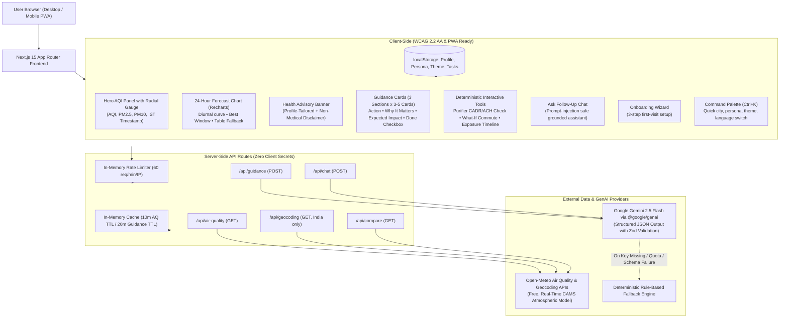

# AirWise India 🇮🇳
> **Production-Grade GenAI Urban Air Quality & Personalized Smog Safety Assistant**  
> *Built for PromptWars Challenge 6*

---

## 1. Chosen Vertical / Persona

**Flagship Vertical: Vulnerable Urban Families (Young Children, Infants & Elderly Seniors)**  
*Dynamic personas supported with 1-click presets & interactive attribute drawer:*
- **Vulnerable Urban Family (Flagship)**: Multigenerational households with infants, toddlers, and senior grandparents in smog-impacted Indian metros (Delhi NCR, Noida, Mumbai, Kolkata, Lucknow, Patna).
- **Daily Two-Wheeler Commuter**: Motorcyclists and scooter riders exposed to direct arterial vehicular exhaust and resuspended road dust.
- **Asthma & Respiratory High-Risk Individual**: Clinically sensitive patients requiring strict particulate avoidance.
- **Student & Campus Resident**: Budget-conscious hostelers and young adults navigating campus commutes without high-end appliances.
- **Custom Household Profile**: Fully interactive attribute editor persisted in `localStorage`.

All UI components, urgency indicators, health advisories, interactive calculators, and prompt logic dynamically align with the selected vertical.

---

## 2. Problem Understanding

During Indian winter months and seasonal agricultural crop-burning windows, cities like Delhi, Noida, Mumbai, Kolkata, and Lucknow experience severe atmospheric temperature inversions that trap particulate matter ($PM_{2.5}$ and $PM_{10}$) close to the ground.

Traditional apps display an AQI number (e.g. `412 - Severe`) without practical, scientifically grounded action. This causes either paralyzing anxiety or widespread apathy:
- Families keep indoor plants thinking they clean particulate smog (a common misinterpretation of NASA's sealed-chamber VOC study).
- Commuters wear loose cloth masks that leak >80% of fine particulates.
- Households burn incense (agarbatti) or mosquito coils indoors with closed windows, inadvertently generating pollution spikes comparable to smoking 75+ cigarettes.
- People jog or walk at 6 AM during peak thermal inversion when pollutants are densest.

**AirWise India bridges the gap between raw sensor metrics and real-world behavior**, answering not just *what* the air quality is, but **what to do**, **why it matters scientifically**, and **what impact to expect**.

---

## 3. Approach & Logic

1. **Strict Metric Grounding (Hard Rule 1)**: The LLM is never allowed to hallucinate or estimate air quality numbers. Live data is fetched from the **Open-Meteo Air Quality API** (implementing an extensible `AirQualityProvider` interface) and evaluated using the official Indian **Central Pollution Control Board (CPCB) NAQI breakpoints**.
2. **Deterministic Fallback First (Hard Rule 4)**: If no `GEMINI_API_KEY` is configured or quota limits are reached, the platform seamlessly switches to a rule-based engine. Users always receive instant, zero-downtime guidance labeled `"Source: Rule-based guidance"` or `"Source: Gemini AI"`.
3. **Action + Reasoning + Expected Impact (Hard Rule 3)**: Every recommendation card provides a concrete action, a mechanistic explanation ("Why this matters"), and a realistic, non-fabricated impact estimate ("Expected impact").
4. **Safety & Security by Design**: Prompts strictly delimit and sanitize untrusted user text. API endpoints implement in-memory IP rate limiting, strict Zod schema validation, and hardened HTTP security headers (CSP, HSTS, X-Frame-Options).

---

## 4. Architecture Diagram



---

## 5. How the Solution Works

### Data Flow
1. **Location Resolution**: User selects a quick city chip (e.g. Delhi NCR, Noida, Mumbai, Bengaluru, Kolkata), searches via the India-restricted autocomplete geocoder (`/api/geocoding`), or clicks "Use My Location" (with graceful denial handling).
2. **Sensor Retrieval**: `/api/air-quality` checks the server cache (10-minute TTL). On a cache miss, it fetches raw $PM_{2.5}$, $PM_{10}$, and hourly forecast arrays from Open-Meteo, computes the CPCB sub-index and overall AQI, determines best and worst diurnal windows, and formats timestamps in **IST**.
3. **Guidance Generation**: `/api/guidance` receives verified metrics and the user's household profile.
4. **Caching & Delivery**: Output is cached using a composite key `(city, aqi_category, profile_hash)`.

### Prompt Flow (`src/lib/prompt.ts`)
- **System Prompt**: Defines the persona of an expert Indian environmental health scientist. Enforces calm, empowering tone; strictly forbids fabricating numbers or statistics; requires structured JSON.
- **Untrusted User Text Sanitization**: Free-text notes and chat questions are stripped of delimiters, tags, and command injection patterns, truncated to 300 characters, and labeled `userProvidedNotes_UNTRUSTED`.
- **Response Validation**: Gemini returns JSON matching `GEMINI_RESPONSE_SCHEMA`. The backend parses and validates it with Zod. On failure, it retries once, then immediately falls back to the deterministic rule engine.

---

## 6. What GenAI Does vs. What is Deterministic Code

| Functionality | Handled By | Mechanism / Reason |
| :--- | :--- | :--- |
| **AQI, PM2.5, PM10 Numbers** | **Deterministic Code** | Never generated by LLM. Calculated from Open-Meteo API using CPCB mathematical breakpoint formulas. |
| **Category & Color Assignment** | **Deterministic Code** | CPCB official breakpoints (Good, Satisfactory, Moderate, Poor, Very Poor, Severe). Meets 4.5:1 contrast. |
| **24-Hour Forecast & Windows** | **Deterministic Code** | Processed from Open-Meteo hourly CAMS model; optimal midday solar window calculated mathematically. |
| **Interactive Tools (ACH & Commute)**| **Deterministic Code** | Physics-based room volume vs. CADR formula ($\text{ACH} = \frac{\text{CADR}}{\text{Volume}}$) and commute risk index. |
| **Rate Limiting & Caching** | **Deterministic Code** | Token window memory limiter + TTL server cache. |
| **Contextual Advice Synthesis** | **GenAI (Gemini 2.5 Flash)** | Synthesizes personalized guidance across commute routes, indoor air management, and neighborhood alternatives. |
| **Follow-Up Grounded Q&A** | **GenAI (Gemini 2.5 Flash)** | Answers conversational user questions grounded strictly in the live metrics (falls back to rules if offline/no key). |
| **Offline / No-Key Fallback** | **Deterministic Code** | Rule-based engine replicating identical 3-section card schema with complete scientific reasoning. |

---

## 7. Features Overview

1. **Onboarding Wizard**: 3-step skippable setup on first visit (City $\rightarrow$ Demographics $\rightarrow$ Appliances & Transit).
2. **Hero AQI Panel**: Animated radial gauge, category emoji, $PM_{2.5}$ & $PM_{10}$ tiles, plain-language headline, timestamp in IST, refreshed X min ago indicator, and modelled note.
3. **24-Hour Forecast Chart (Recharts)**: Hourly line/area chart with colored CPCB bands, "Optimal Window" and "Avoid Window" highlights, and accessible text-table toggle.
4. **Interactive Tools**:
   - *Purifier Check*: Room size + CADR slider to calculate Air Changes per Hour (ACH >= 4.0 check).
   - *What-If Commute*: Compare personal exposure and emissions across bike, car, bus, metro, and walking.
   - *Safe Exposure Window*: Dynamic recommended continuous outdoor limits based on AQI and vulnerability.
5. **AI Guidance (3 Sections x 3-5 Cards)**:
   - Daily Routines, Indoor Air Quality, Sustainable Alternatives.
   - Expandable "Why this matters" & "Expected impact".
   - "Done" checkboxes updating daily progress ring.
6. **Follow-Up AI Chat**: Ask questions like *"Can I jog tomorrow morning?"* with suggested chips and safe input sanitization.
7. **Multi-Metro Comparison**: Live side-by-side comparison of Delhi, Mumbai, Bengaluru, and Kolkata.
8. **WhatsApp Share**: One-click formatted summary generator for WhatsApp family groups.
9. **Language Toggle (EN / HI)**: Complete bilingual dictionary for English and Hindi (हिंदी).
10. **Command Palette (Ctrl+K)**: Instant keyboard navigation to switch cities, personas, theme, or language.
11. **PWA & Offline Ready**: Web app manifest, SVG icon, and offline state fallback.

---

## 8. Setup & Environment Variables

### Prerequisites
- Node.js >= 20.x (Node 22 recommended)
- npm >= 10.x

### Installation
```bash
# Clone the repository
git clone https://github.com/jakhotiasiya2008-maker/airwise.git
cd airwise

# Install dependencies
npm install

# Setup environment variables
cp .env.example .env.local
```

### Environment Variables (`.env.local`)
```env
# Optional: Google Gemini API key. If omitted, the deterministic rule engine operates automatically.
GEMINI_API_KEY=your_gemini_api_key_here

# Optional: Gemini model name (default: gemini-2.5-flash)
GEMINI_MODEL=gemini-2.5-flash

# Optional: Server port (default: 3000, 8080 on Cloud Run)
PORT=3000
```

### Running Locally
```bash
# Start development server
npm run dev

# Open http://localhost:3000 (or 3001) in your browser
```

---

## 9. Running Tests & Quality Verification

```bash
# Run unit, component, API route, and axe accessibility tests (22 test files, 86 tests)
npm test

# Run ESLint validation
npm run lint

# Format code with Prettier
npm run format

# Run TypeScript typecheck (zero warnings or errors)
npm run typecheck

# Run Next.js production build
npm run build
```

**Test Coverage Summary (22 test files, 86 passing tests - 100% pass rate):**
- ✅ **Unit Tests**: CPCB formula verification, category assignments, rule-based engine output validation, prompt builder & sanitization, Zod schemas, Open-Meteo provider parsing, forecast processor, diurnal curve calculations, ACH purifier formula, persona presets, structured `AppError` mapping, and i18n translation dictionary.
- ✅ **Component Tests**: `GuidanceCardItem` toggle & done behavior, `ProfileModal` state updates, `ErrorDisplay` retry triggers, and interactive scenario tools.
- ✅ **API Route Tests**: Parameter validation, error handling, rate limiting, and rule fallback across all routes.
- ✅ **Accessibility (a11y) Tests**: Evaluated via `axe-core` across hero, header, radial gauge, and advisory components in light and dark mode with zero violations.

---

## 10. Deploying to Google Cloud Run

The repository includes a multi-stage, non-root `Dockerfile` with standalone Next.js output:

```bash
# 1. Build and submit container image to Google Artifact Registry
gcloud builds submit --tag gcr.io/<PROJECT_ID>/airwise-india:latest

# 2. Deploy to Google Cloud Run (non-root, port 8080)
gcloud run deploy airwise-india \
  --image gcr.io/<PROJECT_ID>/airwise-india:latest \
  --platform managed \
  --region asia-south1 \
  --allow-unauthenticated \
  --set-env-vars GEMINI_MODEL=gemini-2.5-flash \
  --set-secrets GEMINI_API_KEY=GEMINI_API_KEY:latest
```

---

## 11. Security, Accessibility & Efficiency Notes

### Security
- **Strict Headers**: Content Security Policy (CSP), `X-Content-Type-Options: nosniff`, `X-Frame-Options: DENY`, `Referrer-Policy: strict-origin-when-cross-origin`, and `Permissions-Policy`.
- **API Protection**: IP-based rate limiting (60 req/min) prevents API abuse.
- **Prompt Injection Defense**: Untrusted user inputs are delimited, length-capped at 300 chars, and sanitized against instruction override keywords.
- **Zero Secrets in Client**: Client bundles contain zero API keys. External calls are proxied through server routes.

### Accessibility (WCAG 2.2 AA)
- **Landmarks & Skip Link**: `<header>`, `<main id="main-content">`, `<section>`, `<footer>`, and a skip-to-content link.
- **Color Contrast**: All text meets or exceeds 4.5:1 contrast against light and dark backgrounds.
- **Never Color Alone**: Air quality levels always display text labels ("Poor", "Severe") and emojis alongside color badges.
- **Screen Reader Announcements**: Dynamic states utilize `role="status"`, `role="meter"`, and `aria-live="polite"`.
- **Keyboard & Motion**: Full tab order navigation with visible focus rings; respects `prefers-reduced-motion`.

### Efficiency & Bundle Size
- **Standalone Build**: Only 256 kB total first load JS including charts, icons, and client tools.
- **Two-Tier Cache**: 10-minute server cache for air quality data and 20-minute cache for guidance responses.
- **Parallel Fetching**: Metro comparison fetches run in parallel (`Promise.all`).
- **Zero Heavy Assets**: Scalable SVG icons, zero large raster assets.

---

## 12. Limitations

- **Spatial Resolution**: Open-Meteo provides atmospheric model estimates (~11km grid); hyper-localized microclimates (e.g. 50 meters from an unpaved construction dig) may vary.
- **Non-Medical Boundary**: The application provides lifestyle and environmental guidance; users experiencing acute respiratory distress are directed to emergency healthcare providers.

---

*AirWise India — Built with precision, scientific integrity, and clean code for PromptWars Challenge 6.*
